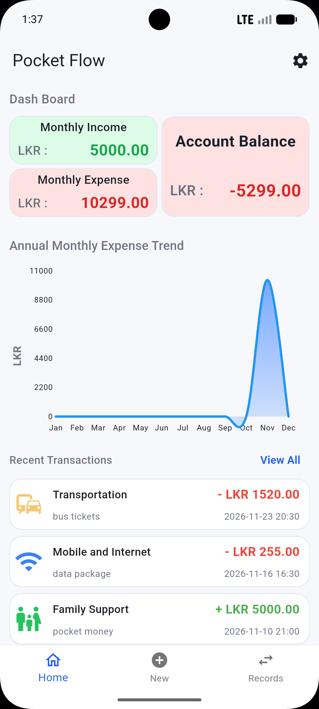
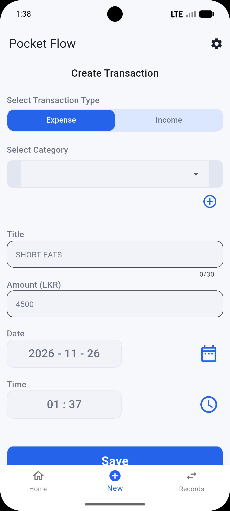
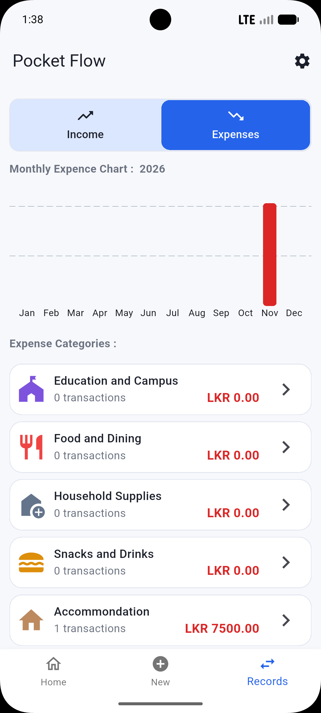
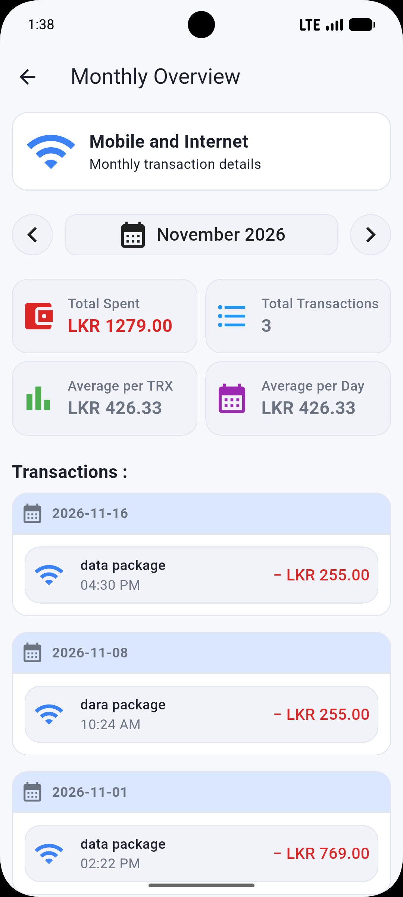

# Pocket Flow

**A simple way to keep track of your money.**

Pocket Flow is a personal income and expense tracker built with Flutter. I made it to have an easy way to record everyday transactions, see where my money goes, and keep an eye on my monthly finances, without a lot of clutter.

> **Version:** v1.0.0

---

## Screenshots

<p align="center">
  
  
  
  
</p>

---

## What you can do with it

**Dashboard**
- See your account balance at a glance.
- Check this month's income and expenses.
- Follow your spending over the year with an expense trend chart.
- Look through your most recent transactions.

**Track income and expenses**
- Add income and expense transactions with a title, amount, date, time, and category.
- Delete a transaction when you no longer need it.
- Amounts are in Sri Lankan Rupees (LKR).

**Custom categories**
- Create your own income and expense categories.
- Pick an icon and a color for each one.
- Edit a category later if you change your mind.

**Transaction history**
- Browse all your past transactions.
- Filter by date range and category.
- Open a category to see only its transactions.

**Records and charts**
- Switch between your income and your expenses.
- See totals for each category.
- Open a Monthly Overview with totals, averages, and a day-by-day breakdown.
- Use charts to see where your money comes from and where it goes.

**Account**
- Register with an email and password, and verify your email.
- Sign in with Google.
- Reset your password if you forget it.
- Log out, or permanently delete your account and all of your data from Settings.

---

## Download

Get the latest Android APK from the [Releases page](https://github.com/Inupa-Maditha/pocket-flow/releases/latest).

1. Download the `.apk` file to your Android phone.
2. Open it. If Android asks, allow your browser or file manager to install apps from this source.
3. Tap **Install**, then open Pocket Flow.

Android may warn you about installing an app from outside the Play Store. That's normal for apps shared this way.

---

## How to use it

1. **Create an account.** Register with your email and password, then open the verification email and confirm your address. You can also sign in with Google instead.
2. **Set up your categories.** Create the income and expense categories you need, like Food, Transport, or Salary, and choose an icon and color for each.
3. **Add transactions.** Whenever you earn or spend money, add a transaction with its title, amount, date, time, and category.
4. **Check your dashboard.** Your balance, this month's income and expenses, the yearly expense trend, and recent transactions are all on the home screen.
5. **Explore your records.** Use the Records section to see totals per category and open the Monthly Overview for a closer look at any month.
6. **Find old transactions.** Use the filters to narrow your history by date range and category.
7. **Manage your account.** Log out or delete your account from Settings.

---

## Run it from source

You'll need [Flutter](https://docs.flutter.dev/get-started/install) (Dart comes with it) and [Git](https://git-scm.com/).

```bash
git clone https://github.com/Inupa-Maditha/pocket-flow.git
cd pocket-flow
flutter pub get
flutter run
```

Connect an Android phone or start an emulator before running `flutter run`.

**About Firebase:** the repository includes its Firebase configuration in `lib/firebase_options.dart`, so the app runs without any extra setup. It connects to my Firebase project, so accounts and data you create while testing go there. Google sign-in may not work on your own machine, because it depends on the app's signing key. If you want your own copy with its own backend, create a Firebase project, enable Email/Password and Google sign-in, set up Cloud Firestore, and replace the configuration with your own (the [FlutterFire CLI](https://firebase.flutter.dev/docs/cli/) makes this easy).

---

## Built with

- **Flutter** and **Dart**: the app itself
- **Firebase Authentication** and **Google Sign-In**: accounts and sign-in
- **Cloud Firestore**: storing categories and transactions
- **fl_chart**: charts
- **flex_color_picker**: choosing category colors
- **fluttertoast** and **intl**: messages and formatting

---

## Project structure

All the app code lives in `lib/`:

```text
lib/
├── main.dart                  # App entry point
├── firebase_options.dart      # Firebase configuration
├── constants/                 # Theme, icons, colors, spacing
├── models/                    # Category and transaction models
├── pages/                     # App screens
├── services/                  # Authentication and Firestore operations
├── shared/                    # Shared app data
└── widgets/                   # Reusable UI components (cards, charts, dashboards)
```

---

## Contributing and feedback

Pocket Flow is a personal project, but feedback and ideas are very welcome. If you find a bug or have a suggestion, please [open an issue](https://github.com/Inupa-Maditha/pocket-flow/issues). If you'd like to fix something yourself, feel free to fork the repository and open a pull request.

---

## Author

**Inupa Maditha**

[LinkedIn](https://www.linkedin.com/in/inupamaditha/) · [GitHub](https://github.com/Inupa-Maditha)

---

## License

Pocket Flow is released under the [MIT License](LICENSE).
